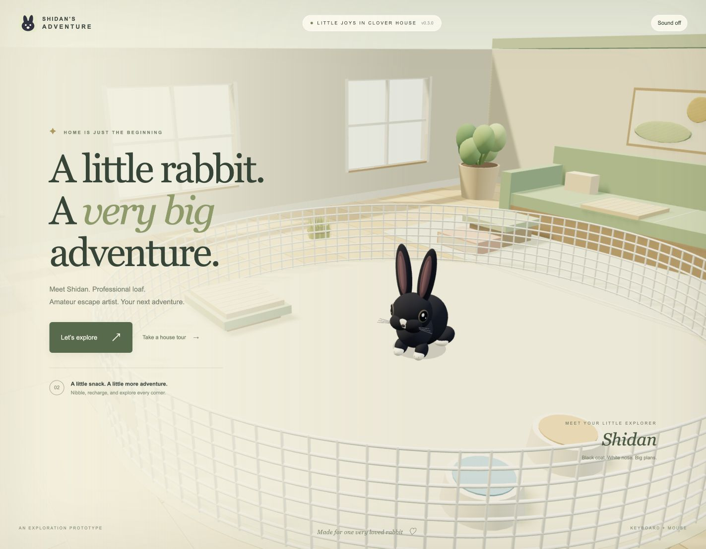
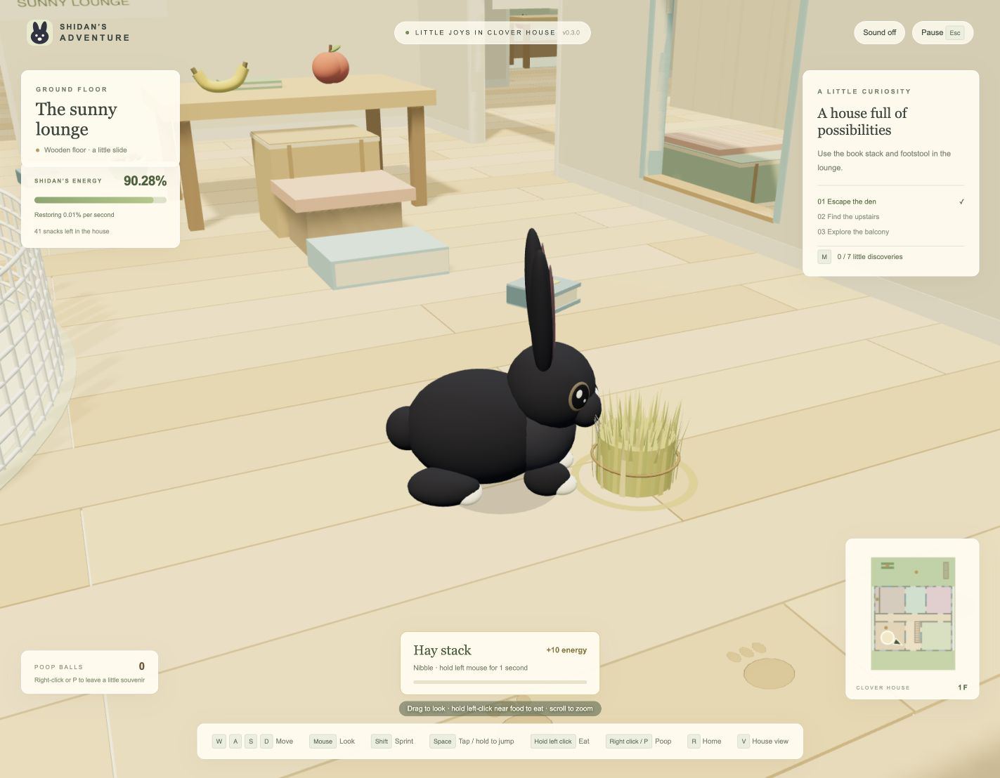
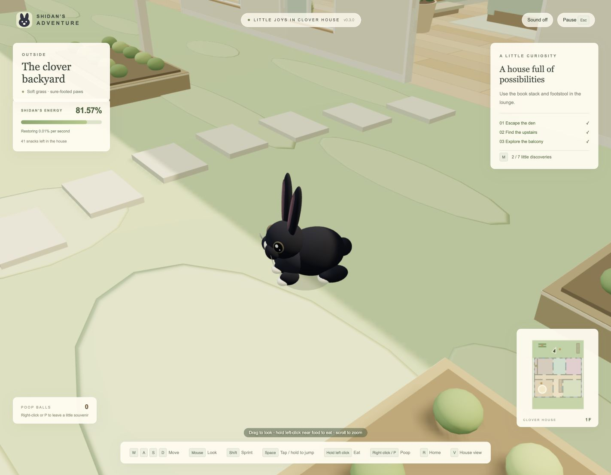
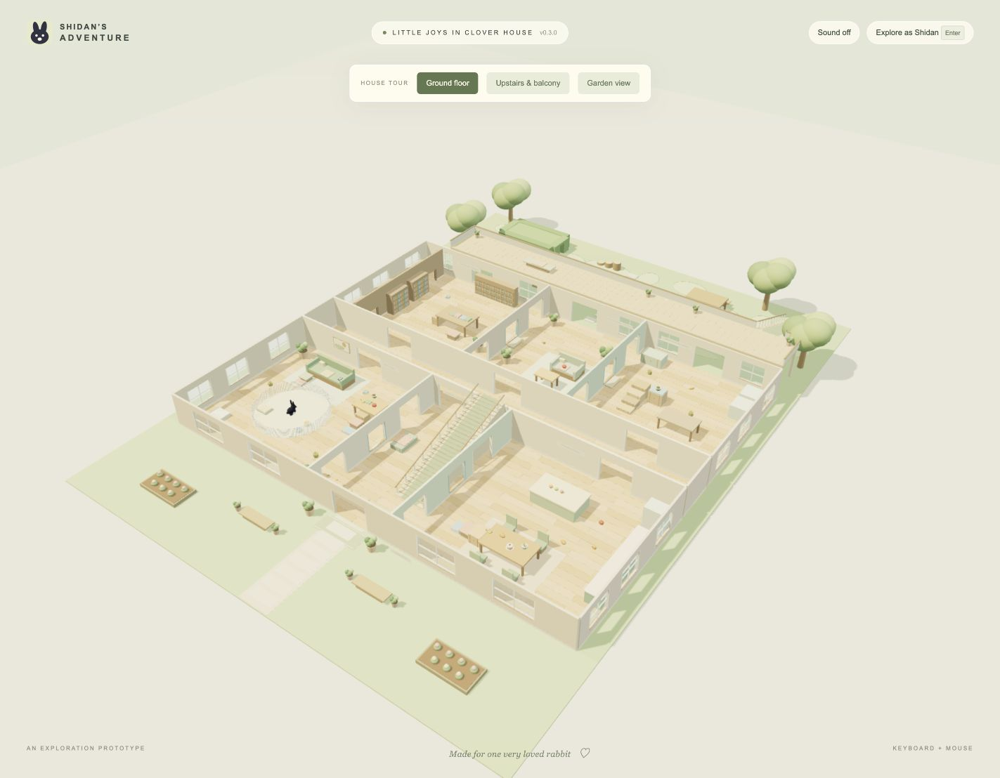

# Shidan’s Adventure

A cozy third-person 3D action adventure starring Shidan, a black rabbit with a white nose patch and white paws. **Explore, snack and recharge during a ten-minute day, from bright noon to a cozy, lamplit night.**

## Screenshots

Captured from the playable v0.3.0 build. Click an image to view it at full size.

| Title screen | Snack time in the sunny lounge |
| --- | --- |
| [](docs/screenshots/title-screen.jpg) | [](docs/screenshots/lounge-snack.jpg) |
| **Exploring the clover backyard** | **A tour of Clover House** |
| [](docs/screenshots/backyard-exploration.jpg) | [](docs/screenshots/house-overview.jpg) |

## Play

**Windows:** double-click `Start-Game.cmd`.

**macOS (Apple silicon or Intel):** install [Node.js LTS](https://nodejs.org/en/download) once, then double-click `Start-Game.command`. The launcher opens the game in your default browser. Keep its Terminal window open while playing; Control-C stops the server. If Finder reports a permission problem after downloading a ZIP, open Terminal in the project folder and run `bash Start-Game.command` instead. See [the macOS guide](docs/MACOS.md).

**Any desktop with Node.js 22 or newer:**

```sh
node scripts/serve.mjs --open
```

Open **http://localhost:4173** if the browser does not open automatically. No package installation, account, build step, or runtime internet connection is needed. The game and Three.js engine are included locally. Use a browser with WebGL 2 support. Mouse capture is optional: drag the scene to look around when capture is unavailable, including in browsers with limited pointer-lock support.

## Controls

| Input | Action |
| --- | --- |
| WASD / arrow keys | Camera-relative movement |
| Mouse | Independently orbit the camera; click to capture it |
| Drag the scene | Camera fallback when pointer lock is unavailable |
| Left Shift | Sprint about 2.5–3× walking speed; uses energy while moving |
| Tap Space | Small hop, triggered on release |
| Hold Space, then release | Charged long jump on bedding, carpet, grass, and balcony; hold a movement key to travel |
| Scroll wheel | Camera distance |
| Hold left mouse near an item or fountain | Eat / chew for the time shown, or keep drinking water; releasing stops the action |
| Right mouse click / P | Spend one carried poop ball; 1-second cooldown |
| Q | Pee for one second; 60-second cooldown before another pee or drink |
| C | Center camera behind Shidan |
| V | House tour with floor, garden-view and Show roof / Look inside choices |
| M | Floor plan, route hints, and discoveries |
| R | Return to the den |
| Esc | Pause / resume; menu includes Restart game; releases the mouse |

**First adventure:** charge a jump in the den and release while moving outward to escape. Your first outward charged jump from inside the den is free each day, even with empty energy. Find the hay outside the den and hold left-click nearby to try eating. Press **M** for the floor plan and seven little discoveries: sofa, library passage, upstairs, bed quilt, balcony, backyard, and hedge hideaway. Collect happiness from food, books, wires, cardboard and slippers while avoiding the mistress.

The mistress follows **15 household and outdoor activities** during play. She starts seated on the lounge couch with her phone, then chooses cooking, eating, laundry, mopping, reading, sleeping, humming, tidying books, watering plants, typing, dusting, shaking a rug, gardening and sweeping the front path. Destinations cover all **14 named areas**, including the balcony and both yards. She walks through doorways and up both stairways at **3.5 m/s**, between Shidan's walking and sprint speeds. Laughter, cooking and the new chores create periodic house-wide noise and soft gold ripples. Each noise episode independently lasts a random **1–5 seconds**, with quiet gaps between episodes. Hearing cover, the noise-cover badge and laughter animation follow that duration while she is actively making noise; leaving or interrupting the activity ends the cover immediately. Walking, including on stairs, never retains cover from a previous sound. Optional sound repeats gentle cues during live episodes. Eating, laundry, mopping, reading and sleeping remain silent. Optional synthesized sound follows the Sound toggle. She interrupts her routine to chase Shidan if she sees or hears her outside the den. Menus pause her, and Restart game or bedtime restores her starting routine.

Her standing height is now **2.68 m**, about 50% taller to match the furniture. The **lower-right minimap** remains visible with the rewards board open. A **red dot** shows her current location only while she is visible in the camera view, with walls and furniture blocking the sighting. Walking within **5 m** creates fading **red rings** around her last heard footsteps, even through walls. The rings last 1.2 seconds, then disappear; they do not leave a tracking dot. Up/down arrows indicate a nearby source on the other floor. Sound can be muted without changing these cues.

Her forward view is a **90° cone reaching 50 m** during household routines and searching as well as pursuit. Visible parts of Shidan's animated body, head or ears can alert her, including on furniture. The floor pattern is amber normally, red during pursuit, and blue while her own activity noise masks hearing. A blue **Your noise is covered** indicator appears during this window, even with Sound off. Masking does not block sight; walls and furniture do. Sleeping disables sight, but an audible noise can wake her. The den is protected from both detection types. Low passages, narrow gaps and other areas she cannot enter suppress Shidan's noise; once sight breaks there during a visual chase, she immediately starts searching.

Chasing starts at **70% of Shidan's terrain-specific sprint speed**, increasing to **75%, 80%, 85% and 90%** at 2, 4, 6 and 8 minutes. Sharp corners make her brake and briefly pause. Tables are not safe hiding spots: once she stands within **1 m of that table's perimeter on the same floor**, she can catch Shidan or clean messes across its **full tabletop**, including the far side, and underneath. This includes the upstairs desk and backyard picnic table. Beds, sofas, the kitchen island, trunks, raised garden beds and the greenhouse roof also allow catches from a reachable edge. The low greenhouse tunnel remains a safe hiding spot. Physical walls, legs and closed glass still block her reach. Food can spawn on tabletops; cake always starts and regenerates on the kitchen dining table. More than **two consecutive seconds without sight** changes a visual pursuit into a walk-and-search lasting **10–20 seconds**. A fresh heard noise instead sends her running to that sound's source, even in another room: she starts searching only after reaching it without seeing Shidan. New sounds update that destination; she does not track an unseen rabbit's current position. For the first two seconds after slowing, she ignores sprint noise; other fresh noises or renewed sight can still alert her. Rejected noises are never replayed later. She can chase through doors into either yard and onto the balcony. She commits to an interception side when Shidan moves around furniture, then adjusts after a short wait if Shidan stays at the far end. Close physical contact can catch Shidan during both pursuit and alert searching. Clear close contact catches Shidan: actions freeze for **three seconds**, then she returns to the den with score, energy and supplies preserved. The mistress appears beside the den, scolds her with an angry animation for **five seconds**, then leaves for a random routine activity from that spot. Her field of view stays active during the rant: seeing Shidan outside the den interrupts it and immediately starts another chase. A quiet rant can also be interrupted by fresh happiness-granting chewing.

Visible, physically reachable messes interrupt her routine or pursuit. She runs to a **poop ball** and spends **0.2 seconds** picking it up. **Pee puddles take priority**, including over an ongoing poop cleanup, and take **10 seconds** to mop. These timers begin after she reaches the mess; Shidan can escape while she works. After cleanup she investigates her latest remembered chewing sound, otherwise chases Shidan if still visible, or searches if sight is lost. Each cleaned puddle adds **5% of Shidan's top sprint speed** to all her movement: **+0.44 m/s** with the current 8.8 m/s top speed. Bonuses stack with each other and the timed chase boosts until a new round. Angry eyebrows and a rage badge show the effect. Capturing/scolding cannot be interrupted by waste.

## Studio shelf

The former upstairs linen tunnel is now an open two-tier shelf. Walk up the front ramp to the **0.9 m lower deck**, then the connecting ramp to the **1.9 m Springboard**. Both carpeted levels allow charged jumps, food and random chewables. The lower level starts with a book and the upper level with a banana; the takeoff area stays clear. A charged jump from the upper edge reaches the studio desk. Both levels remain within the mistress’s reach. Shidan folds her ears and tucks when overhead clearance is tight, preserving her normal jump strength.

## Energy, happiness and consumables (0.6.0)

Energy starts at **100.00%**, displayed to two decimal places. A full bar supports **30 seconds of continuous sprinting**, including passive recovery. Charged jumps cost **5–10 energy**, depending on charge time. Each new day grants one free outward charged jump from inside the den; stationary charged jumps still cost energy. Returning home or visiting the title preserves whether this allowance has been used, and the next day renews it. Ordinary movement and small hops (including charged inputs on slippery wood) are free. Standing still with Shift is free. Empty energy restores ordinary speed; release Shift before sprinting again. A charged jump without enough energy becomes a free small hop.

Passive recovery is **0.01 energy per second**, applied smoothly. Hold left-click near an item for the uninterrupted time shown in its prompt to consume it. Early release, leaving reach, jumping away, and menus cancel the hold. Walls and floors block eating through them. The item shrinks into golden particles and restores energy over **one second**, capped at 100. One press consumes one item. Eating at full energy still uses the item.

Consumption time in seconds is **`max(1, energy / 25 + happiness / 50)`**, rounded up to the next **0.1 second**. Use the item’s listed rewards rather than the energy currently missing from the bar. The special den hay uses 100 energy in this formula, so its full refill takes four seconds. Every item takes at least one second; larger combined rewards take longer. Poop-ball rewards do not change the hold duration.

Each round starts with **40 snacks, 10 cables at authored spots, 8 random boxes, 4 random pairs of slippers, and 1 permanent hay stack**. Spawn locations are checked against the mistress's human navigation: food and chewables cannot generate inside rabbit-only passages or hideaways. This applies to initial items, respawns and restocking. The den's permanent recovery hay stays available. Happiness is awarded immediately, only after a full uninterrupted hold; energy rewards recover over one further second. The special hay instead refills energy instantly. Energy is capped at 100; happiness has no cap or target yet.

| Item | Initial | Min–max present | Regeneration | Hold | Energy | Happiness | Carried poop balls |
| --- | ---: | ---: | --- | ---: | ---: | ---: | ---: |
| Special den hay | 1 | 1–1 | Permanent / reusable | 4 s | Refill to 100% | 0 | +3 once per den visit |
| Carrot | 8 | 0–8 | Shared snack rule* | 1 s | +20 | +10 | +2 |
| Book | 11 | 0–11 | Shared snack rule* | 1 s | +10 | +20 | +2 |
| Hay stack | 6 | 0–6 | Shared snack rule* | 1.6 s | +40 | 0 | +3 |
| Apple | 4 | 0–4 | Shared snack rule* | 2 s | +25 | +50 | +2 |
| Rabbit food | 3 | 0–3 | Shared snack rule* | 2.4 s | +20 | +80 | +2 |
| Banana | 3 | 0–3 | Shared snack rule* | 1.6 s | +20 | +40 | +2 |
| Bread | 2 | 0–2 | Shared snack rule* | 1.6 s | +30 | +20 | +2 |
| Noodles | 2 | 0–2 | Shared snack rule* | 1.4 s | +30 | +10 | +5 |
| Cake | 1 | 0–1 | 120 s after consumption, kitchen dining table | 5 s | +50 | +150 | +5 |
| Wire / cable | 10 | 0–10 | 30 s per consumed cable, original location | 3 s | 0 | +150 | 0 |
| Cardboard box | 8 | 0–8 | 60 s per consumed box, random location | 2.8 s | +20 | +100 | 0 |
| Slippers (one pair = one item) | 4 | 0–4 | 90 s per consumed pair, random location | 4 s | 0 | +200 | 0 |
| Dropped poop ball | 0 | 0–1,000 | Player drops one from carried supply | 1 s | +5 | 0 | 0 |

The **Item rewards** board on the right lists energy and happiness for all fifteen interactions, including special den hay, dropped poop and water. Its values come from the same definitions as consumption. **100%** for special hay means a full refill; water fills only the bladder. Select the board's heading to collapse it, or scroll the table to reach all rows. The minimap and map/discoveries button stay visible below it. Ordinary hay now gives **40 energy** and takes **1.6 seconds**; special den hay still refills to 100% after four seconds.

*Eight regular snack types share a restock pool: below two regular snacks remaining, one random regular snack appears every 60 seconds, stopping at two. This pool starts with 39 items and excludes cake. This is not a separate cooldown for each regular snack; kind probabilities are weighted by inverse energy. Cake has its own 120-second cooldown and returns only to its reserved spot on the kitchen dining table, even if it was pushed elsewhere before being eaten, with a maximum of one available. Wires likewise respawn at their original appliance or lamp locations. Cake, wires, boxes and slippers never enter or suppress the regular-snack restock pool. Min–max means currently available items, not total spawns over a round; a depleted type may temporarily have zero. Respawn delays count active play, not menus or inactive tabs, and begin after full consumption.

Cables begin beside the TV, oven, library desk, studio computer and six floor lamps. Random boxes and slippers begin at clear, reachable locations on both floors, the balcony and yards, outside the den and rabbit-only passages. Each random respawn chooses a free location, away from Shidan and other items. Every consumable can be nudged or pushed, including food, loose books, cables, boxes, slippers and permanent den hay. Contact slows Shidan by about **10%**, or **18% for boxes**, while the item yields instead of acting as a fixed wall. Items carry a little momentum, slow through friction, and fall under gravity if pushed off furniture. They collide with scenery, the den fence, lot boundaries, other loose items and poop balls.

Fully consuming a finite item removes its body along with the prop; respawning restores both. Permanent den hay keeps its body after use and can be nudged around inside the den, but its fence keeps this recovery point inside. Loose consumables move instead of becoming climbing platforms. The original structural crates, book steps and other furnishings remain solid climbing routes.

Inside the den, **special hay in a cream dish with a mint bow** is within reach of Shidan’s starting position. Hold left-click for **four uninterrupted seconds** to restore energy immediately to **100%**, even from zero. This stack is permanent and reusable; it stays visible after eating and is excluded from the snack count and random restocking. It can be nudged within the den while retaining the same refill interaction. It prevents running out of energy from trapping Shidan inside the fence.

## Poop supply and water

Each day starts with **10 carried poop balls**, capped at **20**. The lower-left counter shows carried supply, rather than the number on the map. Right-click or P spends one and starts a **one-second active-play cooldown**; empty supply prevents another drop. Finishing food or books grants the balls in the table above, capped at 20. Special den hay grants three on the first completed hold of a den visit, including the starting visit. Leave the den and land back inside to renew that reward; jumping straight up or eating repeatedly while staying inside does not renew it. A visit’s grant is used even at capacity. Repeated hay consumption can still refill energy.

Dropped balls keep their gravity, rolling and collisions, and can be pushed. Hold left-click near one for **one second** to eat it, remove it and recover **five energy** over the usual one-second recovery period. It grants no happiness or carried balls and does not count as a regular snack. At most **1,000 dropped balls** remain on the map; a new drop beyond that limit replaces the oldest. Home, title and menus preserve both supply and dropped balls; bedtime starts again with ten carried balls and an empty map.

There are **14 immovable water fountains**, one in every authored room/area, including the halls and balcony, plus the front and back yards. Each starts with **100 percentage points of water**, enough to fill one empty bladder. Hold left-click nearby to drink with a nibbling motion from Shidan. The bladder starts empty and fills at **10 percentage points per second**: 0.1 second adds exactly 1%, and filling stops at 100% or when that fountain is empty. Only the water actually drunk leaves its reservoir: drinking 25% leaves 75% for later. Each fountain has its own supply; the prompt shows what remains, and an empty fountain stays empty until the next round or Restart game. The left-side bladder meter shows two decimal places. Water grants no energy, happiness or poop balls.

Press **Q** only when the bladder is **100% full** to begin a **one-second pee action**, gradually emptying it to 0% and leaving a puddle beneath Shidan. Movement, jumping, eating, drinking and pooping are unavailable until the action finishes. A **60-second active-play cooldown starts when peeing begins**, blocking another pee or drink until it expires. Pressing Q below 100% or while cooling down does nothing; it preserves the bladder and does not start or extend a cooldown. Larger poop and pee timers show decimal seconds, with a progress bar during peeing. Menus and inactive tabs freeze actions and cooldowns. R/Home and manual title navigation preserve bladder, remaining fountain water and cooldown state; bedtime or Restart game clears actions and refills every fountain. The countdown and happiness panel sits at the **upper right**, with the original Clover House header banner and curiosity panel removed. Map/discoveries are attached to the minimap, with a compact visible button on smaller screens.

The 40 finite snacks (39 regular snacks and one cake) start and respawn outside the den. The loose collectible books are separate from solid climbing steps. While fewer than **two regular snacks** remain, one appears every **60 seconds of active play**, stopping at two. The choice of kind is weighted by **1 / energy reward**, then placed in a vacant appropriate spot outside the reserved cake location. Cake returns independently **120 seconds** after full consumption, even while other snacks remain. Pause, map, house tour, title, and background tabs freeze resource timers. Home/title navigation preserves supplies, energy, and pending food recovery; reloading starts a fresh session.

## Noise

An actual **long-jump launch** and **sprinting while moving** create gameplay noise with a **5 m radius measured in three dimensions**. Height matters: being directly above a source does not remove the distance between floors. Short tap jumps and holding Shift while standing still are silent.

Holding left-click to consume any item with **positive happiness** creates noise audible to the mistress **anywhere on the map**, including both stairways, the balcony, either floor and both yards. Walls, distance and floor transitions do not block it. The existing protection for noise originating inside the den or rabbit-only hiding passages remains. Noise begins during the eating or chewing hold, so cancelling before a reward is earned still leaves the noise already made. Ordinary hay, special den hay, eating dropped poop balls and drinking grant no happiness and stay silent for this mechanism.

Subtle expanding ripples mark noisy actions. Stopping the sprint or consumption hold stops new emissions; existing ripples finish fading. Menus freeze noise time, and a new round or Restart game clears its state. The **Sound** button controls audible effects without changing gameplay hearing. The mistress hears these events unless her own activity noise masks them or Shidan is in a protected hiding area.

## Noon to bedtime (0.4.0)

Each adventure lasts **10 minutes of active play**. The **Until bedtime** clock starts at **10:00**, with bright blue daylight. The sky and household lighting gradually move through afternoon and a peach-and-lavender dusk. By **2:00 remaining** (eight minutes elapsed), the sky is fully night: stars and a moon appear, and ceiling pendants and floor lamps cast warm light throughout the house.

Menus, the map, house view, the title screen, and inactive tabs pause the clock. Returning home or manually visiting the title preserves the remaining time. The timer uses real elapsed time independently of the physics frame cap. At **0:00**, the round freezes and opens **Game Over**. The completed happiness score is saved under the player’s name. Results show the final score, rank among all locally saved runs (ties share a rank), every item consumed, poop balls dropped, water drunk, urine produced, puddles created, jumps, sprint time, distance, captures and messes cleaned by the mistress. Water and urine use bladder percentage points: 100% equals one full bladder. Choose **Start a new game** for a fresh noon round as the same player, or **Back to main menu** to choose another adventure. Each choice resets round resources and statistics while preserving saved scores.

**Restart game** in the Escape menu discards the unfinished round and starts a fresh one under the same player name. It restores **10:00 at noon, zero happiness, full energy, ten carried poop balls, an empty bladder, full fountains and fresh items**. Dropped balls, puddles, discoveries, pending recovery and cooldowns are cleared, and the free first den jump is renewed. Previously completed leaderboard scores remain saved; restarting never records the abandoned score. **R / Home** still returns Shidan to the den while preserving the current round.

The 18 fixtures have solid bases, stems and shades. Their glowing diffusers use two instanced batches; four reusable local lights illuminate the nearby rooms without casting extra shadow maps. The day cycle retains the existing cached sun direction and shadows.

## Local happiness leaderboard

Enter a name (up to 24 characters) before playing. The HUD shows the current player and happiness total. At exactly ten minutes, the score and name are recorded, the title displays the result, and **Happiness leaderboard** shows the top ten completed adventures. Every completed run is retained, including zero scores and repeated names; highest scores rank first, with earlier completion breaking ties. No online account or connection is needed.

Records and the last-used name live in this browser’s local storage on this address. Reloading preserves finished scores but abandons the in-progress round. Different browsers, devices, hostnames or ports have separate boards; clearing site data clears saved scores. If storage is blocked or full, play still works and the result clearly says it is kept only for the current page session. Manual title navigation resumes the same named run and never records a partial score.

## Included in milestone 1

- A rebuilt **48 × 40 m house**, an **8 m diameter den**, and a **52 × 18 m backyard**. Shidan remains her original size; the pen fence is 1.1 m high.
- A **52 × 12 m front yard** with a clear entrance path, benches and flower beds. An invisible boundary encloses the full **52 × 70 m lot**, including the side paths.
- Moderate indoor wood slip, firm outdoor grip, and faster sprinting. The den wires align, wall joins do not overlap, and cached shadows plus nearby collision lookup reduce frame work.
- Seven ground-floor areas, including the entrance and cross-hall, three upstairs rooms, a gallery, a full garden balcony, and two usable stairways.
- Interconnected door routes, eight jump-through windows, 32 see-through solid exterior windows, a concealed library passage, an upstairs ramp shelf and a low hedge tunnel.
- Climbable sofa, coffee table, dining table, stacked crates, bed, and desk. Books, poufs, stools and trunks form reachable steps.
- Solid cushions, blankets, mattress, quilt, pillows and furniture layers. Rendered box surfaces and collision share the same dimensions.
- A complete pitched pastel roof and ceilings over the full house. They stay visible during ordinary play; **V** and house tours begin with them hidden for floor-plan inspection. **Show roof** closes the house in the tour; **Look inside** restores the cutaway. Upstairs walls are visible from outside, preserving the two-story exterior.
- Front-wing ceilings at **3.9 m** and rear upstairs / central stair-hall ceilings at **8.1 m**, leaving the full stair route clear. The shell uses five drawing submissions: two ceiling batches and three roof sections.
- Early upstairs reveal on stair approaches, floor cutaways, a floor-aware minimap, full map, garden tour angle, and seven optional discoveries.
- Original procedural Shidan model based on the three local reference photos, with black fur, white nose marking, white toes, ears, whiskers and a fluffy tail.
- Breathing, blinking, ear movement, running gait, crouch and airborne poses.
- Third-person orbit camera, running, tap jumps, charged jumps, furniture/ceiling collision, stair traversal and floor-dependent traction.
- Pause/resume, full-round Restart game, map/discoveries, and optional synthesized sound effects.
- Right-click poop balls with gravity, rolling, bounce and collisions against the house, fence, stairs, Shidan and one another. Resting balls can be nudged awake by Shidan.
- Up to **1,000 dropped balls** persist until eaten or cleaned, including through pause, return-home and manual title navigation. Each additional ball replaces only the oldest. Carried supply starts at ten and is capped at twenty. Bedtime or reloading the page starts a fresh session.
- Fourteen fixed drinking fountains with a full bladder's water each per round, a precise bladder meter, a one-second Q pee action and visible 60-second pee/drink cooldown.
- Gameplay noise from long jumps, moving sprints and happiness-granting consumption, with subtle ripples and hearing queries ready for a future NPC.
- A jointed mistress character with fifteen timed household/outdoor activities, navigation through all rooms and both yards, noisy chores and an angry scolding animation.
- Local source control, automated physics checks, browser integration checks, and a static distribution build.

**Later milestones:** more interaction types; the cotton cover; scoring balance and an optional happiness target.

## Surface stability checks

The regression suite audits the complete house, furnishings, every consumable kind and several Shidan poses for differently coloured surfaces sharing the same plane. It repeats the house check after geometry batching and checks nearby items while pushing. Intentional touching edges, embedded curved parts and fully concealed faces are handled separately from exposed surface conflicts. Floor paint and rugs use a small depth bias, while ordinary solid joins use real geometric clearance.

## Develop and verify

```sh
node scripts/check.mjs
node --test
node scripts/build.mjs
node scripts/serve.mjs --dist
```

`node scripts/benchmark-level.mjs` compares indexed and full-scan character collision on identical movement traces. Read-only `data-performance` on the game canvas reports sampled frame/CPU timing and render counts for local profiling.

`npm run dev`, `npm test`, `npm run check`, and `npm run build` are aliases if npm is installed. The plain Node commands also work with the bundled runtime available on this computer.

For input integration checks, run the development server, open **http://localhost:4173/tests/browser.html**, and click **Run input and menu checks**. Keep that tab foreground while the checks run. The runner exercises actual input, mouse error recovery, poop, fast tap buffering, charged escape, pause/resume, maps, cutaways and title navigation. The separate **Walk the balcony–garden loop** button walks the real game through the entrance, both floors, balcony, garden stairs and back inside. Keep this tab active until it finishes. **Check stair visibility** walks to the middle of the indoor stairs, verifies the ceiling and upstairs reveal, and checks that sunlight shadows remain cached.

**http://localhost:4173/tests/body-resources.html** runs actual-game poop supply, den hay, drinking, pee, cooldown and new-day checks using an isolated score store and controllable active clock. Add `?actions` to focus on animation, one-second action locking, cooldowns and a full restart, or `?preview` for a clean full-window visual preview without changing your saved name or leaderboard.

Add `?noise` to check actual long-jump/sprint noise, quiet actions, house-wide partial chewing, ripple lifetimes, pause behavior and fresh-round cleanup through the real game controls.

Add `?legend` to check all fifteen energy/happiness rows, the current hay reward, the reference board's layout, keyboard behavior and restart persistence.

Add `?minimap` to check the restored map, taller model, visible versus off-camera markers, nearby heard footsteps, fading, pause and restart.

Add `?pursuit` for actual-control detection, chase warnings, capture/input locking, precise return/scolding timing, preserved resources, random routine resumption, difficulty tiers and restart. `?pursuit&capture` stops at a chase; `?pursuit&scold` stops at the angry den animation. `?mistress&cover` previews the noise-cover indicator. `?mistress&noise-duration` checks the randomized duration, exact expiry and pause behavior; `?pursuit&tables&capture` drives the kitchen stepping route, reaches its cake and verifies a tabletop catch. Add `&orbit` to keep moving around the tabletop during pursuit. `?pursuit&tables&across&capture` shows sight detection and a catch across the kitchen table from the mistress's original side while Shidan stays on the far half. `?pursuit&scold-escape&capture` verifies a second den escape during the angry rant. These previews use isolated scores and a controllable clock.

For rendering measurements, open **http://localhost:4173/tests/performance.html**, select a view size, and run the six-second camera orbit. Keep the test tab active. It reports frame intervals, CPU work, asynchronous GPU time where supported, and drawing submissions. `node scripts/benchmark-render.mjs` measures visible geometry across six locations; it is not an FPS test.

The build writes `dist/`, which can be served by any static HTTP host. It has no runtime CDN calls, analytics or backend. Double-clicking `index.html` directly is unsupported because browser ES modules require an HTTP origin.

The browser QA page also has **Run energy and eating checks**. It starts a fresh session, exercises sprint/jump costs, interrupted and completed holds, gradual recovery, and home/title persistence. **Check permanent den hay** tests cancelled holds, full refills and repeated use through the actual game controls. Unit tests simulate exhaustion, a refill followed by escape, 30-second sprinting and restocking without waiting in real time.

Open **http://localhost:4173/tests/day-cycle.html** to preview noon/dusk/night or run the countdown checks. This test entry supplies a manually advanced clock to the actual game, verifying menu pauses, night at 2:00, timeout, and a clean restart without waiting ten minutes. Normal play uses the real monotonic clock; preview controls are excluded from the distribution build.

## Project map

| Path | Purpose |
| --- | --- |
| `src/main.js` | Scene, input, orbit camera, game state and tutorial UI |
| `src/start.js` | Production entry point with the real-time clock |
| `src/day-cycle.js` | Ten-minute clock, phase progression and countdown formatting |
| `src/day-lighting.js` | Sky, stars, moon, daylight and fixed local-light pool |
| `src/house-lamps.js` | Ceiling/floor fixtures, collision and instanced glowing diffusers |
| `src/adventure-session.js` | Clean resource reset at bedtime or Restart game |
| `src/physics.js` | Independent character controller, collision, stairs and traction |
| `src/layout.js` | Room, wall, opening, ramp, and discovery data |
| `src/level-map.js` | Shared minimap and full floor plan |
| `src/mouse.js` | Mouse actions and safe pointer-lock/drag fallback |
| `src/poop-physics.js` | Sphere collision, sleep/wake, spatial indexing and 1,000-ball pool |
| `src/poop.js` | Instanced poop-ball rendering |
| `src/poop-supply.js` | Carried ball cap, drop cooldown and once-per-visit den reward |
| `src/water.js` | Fountain placement/reach, finite water reserves, precise drinking, bladder and pee cooldown |
| `src/fountains.js` | Fixed fountain models and pooled pee-puddle rendering |
| `src/model.js` | Procedural rabbit model, animation and geometry helpers |
| `src/rabbit-clearance.js` | Static overhead clearance for compact ear/body poses |
| `src/mistress-model.js` | Animated mistress and activity props |
| `src/mistress-ai.js` | Timed household routines |
| `src/mistress-navigation.js` | Cached indoor/outdoor human routes, safe areas and search targets |
| `src/mistress-pursuit.js` | Hearing, masking, chase/search/capture state and speed tiers |
| `src/mistress-vision.js` | Forward cone, physical cover and contact checks |
| `src/mistress-cone.js` | Floor-projected field-of-view pattern |
| `src/mistress-awareness.js` | Camera sightings and nearby minimap footsteps |
| `src/mistress-cleanup.js` | Bounded waste visibility, physical reach and cleanup targets |
| `src/energy.js` | Sprint/jump costs, passive recovery, timed food rewards |
| `src/happiness.js` | Completed scores and full local leaderboard ranking |
| `src/round-stats.js` | Per-round item, waste, water and movement statistics |
| `src/table-refuges.js` | Table footprints and perimeter checks for capture and cleanup |
| `src/consumable-data.js` | Nine finite item kinds, 39 eligible authored locations, and special den hay |
| `src/consumable-system.js` | Reach/occlusion, reward-scaled holds, item bodies and restocking |
| `src/consumable-legend.js` | Shared-data energy/happiness table for the in-game rewards board |
| `src/consumables.js` | Instanced snack models, selection ring, disappearance particles |
| `src/house.js` | House structure, true openings, den, stairs and static batching |
| `src/furnishings.js` | Climbing furniture, blankets, garden and cover |
| `src/audio.js` | Original Web Audio effects |
| `src/noise.js` | Gameplay noise events, local/house-wide hearing and listener queries |
| `src/noise-ripples.js` | Instanced expanding ripples for noisy actions |
| `tests/` | Physics and browser integration checks |
| `docs/DESIGN.md` | Story, game design and implementation decisions |
| `docs/LEVEL.md` | Clover House routes, dimensions, climbing and future AI constraints |
| `docs/MACOS.md` | Mac setup, launcher and trackpad controls |
| `docs/ROADMAP.md` | Milestones and acceptance criteria |
| `docs/ASSETS.md` | Asset origins, licenses and future candidates |
| `docs/QA.md` | Verification and current limitations |
| `vendor/` | Pinned Three.js 0.180.0 with its MIT license |
| `pic/` | Local reference photos; excluded from Git, HTTP serving and builds |

## License

The repository’s original Apache-2.0 license is retained for project code and original assets. Three.js remains under its own MIT license in `vendor/THREE-LICENSE.txt`. Shidan’s personal reference photographs are not distributed. See `docs/ASSETS.md` for attribution and asset provenance.
