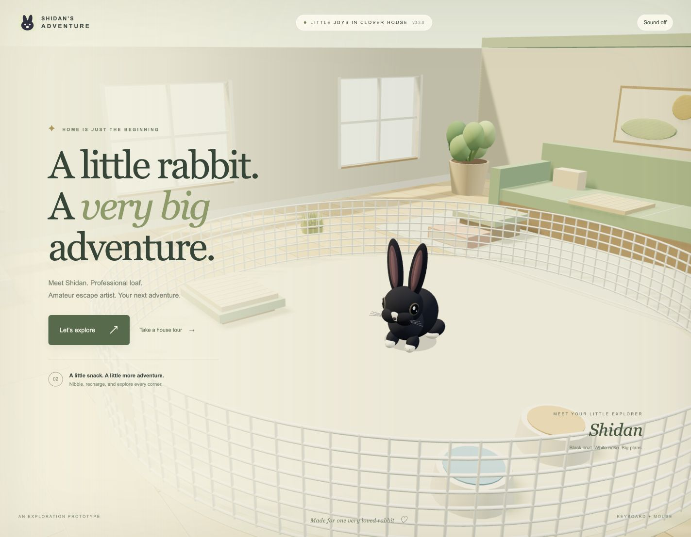
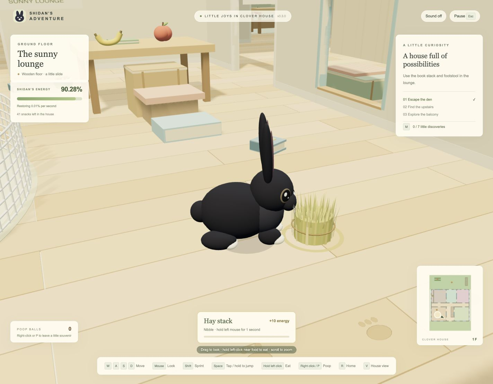
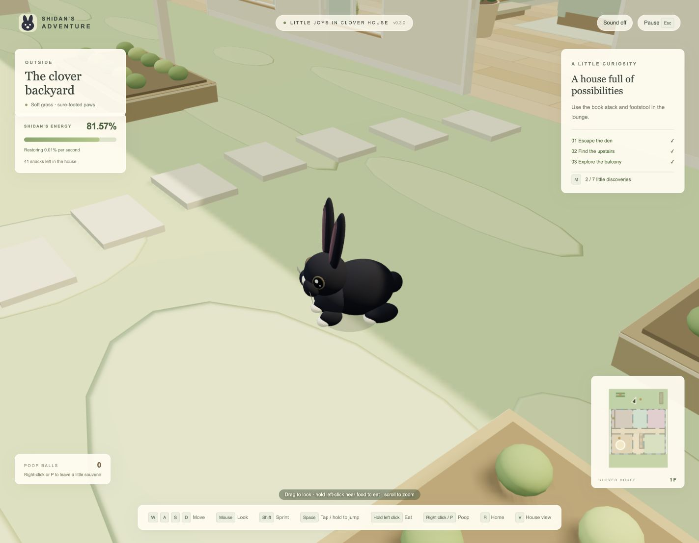
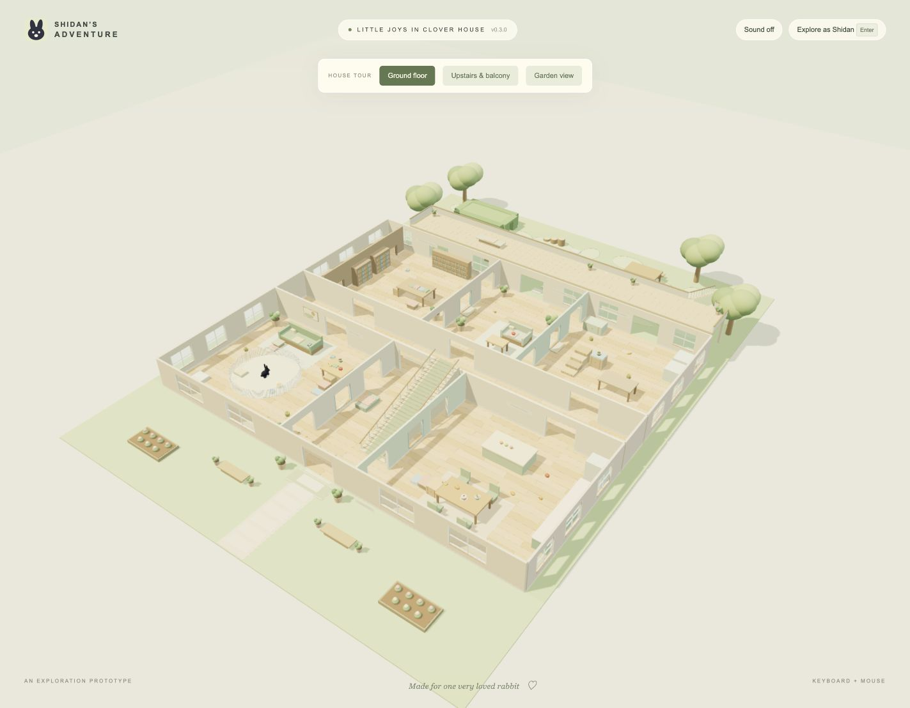

# Shidan’s Adventure

A cozy third-person 3D action adventure starring Shidan, a black rabbit with a white nose patch and white paws. **Milestone 2 adds energy, snacks, and chewing to the playable house.**

## Screenshots

Captured from the playable v0.3.0 build. Click an image to view it at full size.

| Title screen | Snack time in the sunny lounge |
| --- | --- |
| [](docs/screenshots/title-screen.jpg) | [](docs/screenshots/lounge-snack.jpg) |
| **Exploring the clover backyard** | **A tour of Clover House** |
| [](docs/screenshots/backyard-exploration.jpg) | [](docs/screenshots/house-overview.jpg) |

## Play

**Windows:** double-click `Start-Game.cmd`.

**macOS (Apple silicon or Intel):** install [Node.js LTS](https://nodejs.org/en/download) once, then double-click `Start-Game.command`. The launcher opens the game in your default browser. Keep its Terminal window open while playing; Control-C stops the server. If Finder reports a permission problem after downloading a ZIP, open Terminal in the project folder and run `bash Start-Game.command` instead. See [the macOS guide](docs/MACOS.md).

**Any desktop with Node.js 22 or newer:**

```sh
node scripts/serve.mjs --open
```

Open **http://localhost:4173** if the browser does not open automatically. No package installation, account, build step, or runtime internet connection is needed. The game and Three.js engine are included locally. Use a browser with WebGL 2 support. Mouse capture is optional: drag the scene to look around when capture is unavailable, including in browsers with limited pointer-lock support.

## Controls

| Input | Action |
| --- | --- |
| WASD / arrow keys | Camera-relative movement |
| Mouse | Independently orbit the camera; click to capture it |
| Drag the scene | Camera fallback when pointer lock is unavailable |
| Left Shift | Sprint about 2.5–3× walking speed; uses energy while moving |
| Tap Space | Small hop, triggered on release |
| Hold Space, then release | Charged long jump on bedding, carpet, grass, and balcony; hold a movement key to travel |
| Scroll wheel | Camera distance |
| Hold left mouse for 1 second near a snack | Eat or chew; releasing early cancels |
| Right mouse click / P | Drop one poop ball behind Shidan |
| C | Center camera behind Shidan |
| V | House tour with floor and garden-view choices |
| M | Floor plan, route hints, and discoveries |
| R | Return to the den |
| Esc | Pause / resume; releases the mouse |

**First adventure:** charge a jump in the den and release while moving to escape. Find the hay outside the den and hold left-click nearby to try eating. Press **M** for the floor plan and seven little discoveries: sofa, library passage, upstairs, bed quilt, balcony, backyard, and hedge hideaway. AI pursuit and happiness scoring remain later milestones.

## Energy and consumables (0.3.1)

Energy starts at **100.00%**, displayed to two decimal places. A full bar supports **30 seconds of continuous sprinting**, including passive recovery. Charged jumps cost **5–10 energy**, depending on charge time. Ordinary movement and small hops (including charged inputs on slippery wood) are free. Standing still with Shift is free. Empty energy restores ordinary speed; release Shift before sprinting again. A charged jump without enough energy becomes a free small hop.

Passive recovery is **0.01 energy per second**, applied smoothly. Hold left-click for one uninterrupted second near a snack to consume it. Early release, leaving reach, jumping away, and menus cancel the hold. Walls and floors block eating through them. The item shrinks into golden particles and restores energy over **one second**, capped at 100. One press consumes one item. Eating at full energy still uses the item.

The house starts with **41 consumables** at fixed, reachable feeding places, kitchen tables, furniture, and library/studio corners on both floors:

| Item | Energy | Initial count |
| --- | ---: | ---: |
| Book | +2 | 12 |
| Carrot | +5 | 8 |
| Hay stack | +10 | 6 |
| Apple | +15 | 4 |
| Rabbit food | +20 | 3 |
| Banana | +20 | 3 |
| Bread | +25 | 2 |
| Noodles | +30 | 2 |
| Cake | +50 | 1 |

Inside the den, **special hay in a cream dish with a mint bow** is within reach of Shidan’s starting position. Hold left-click for one uninterrupted second to restore energy immediately to **100%**, even from zero. This stack is permanent and reusable; it stays visible after eating and is excluded from the snack count and random restocking. It prevents running out of energy from trapping Shidan inside the fence.

The 41 finite snacks and their restocks stay outside the den. The loose collectible books are separate from solid climbing steps. While fewer than **two** finite items remain, one appears every **60 seconds of active play**, stopping at two. The choice of kind is weighted by **1 / energy reward**, then placed in a vacant appropriate spot. Pause, map, house tour, title, and background tabs freeze resource timers. Home/title navigation preserves supplies, energy, and pending food recovery; reloading starts a fresh session.

## Included in milestone 1

- A rebuilt **48 × 40 m house**, an **8 m diameter den**, and a **52 × 18 m backyard**. Shidan remains her original size; the pen fence is 1.1 m high.
- A **52 × 12 m front yard** with a clear entrance path, benches and flower beds. An invisible boundary encloses the full **52 × 70 m lot**, including the side paths.
- Moderate indoor wood slip, firm outdoor grip, and faster sprinting. The den wires align, wall joins do not overlap, and cached shadows plus nearby collision lookup reduce frame work.
- Seven ground-floor areas, including the entrance and cross-hall, three upstairs rooms, a gallery, a full garden balcony, and two usable stairways.
- Interconnected door routes, eight jump-through windows, 32 see-through solid exterior windows, concealed library and linen passages, and a low hedge tunnel.
- Climbable sofa, coffee table, dining table, stacked crates, bed, and desk. Books, poufs, stools and trunks form reachable steps.
- Solid cushions, blankets, mattress, quilt, pillows and furniture layers. Rendered box surfaces and collision share the same dimensions.
- An always-visible ceiling during play, early upstairs reveal on stair approaches, floor cutaways, a floor-aware minimap, full map, garden tour angle, and seven optional discoveries.
- Original procedural Shidan model based on the three local reference photos, with black fur, white nose marking, white toes, ears, whiskers and a fluffy tail.
- Breathing, blinking, ear movement, running gait, crouch and airborne poses.
- Third-person orbit camera, running, tap jumps, charged jumps, furniture/ceiling collision, stair traversal and floor-dependent traction.
- Pause/resume, reset, exploration guidance, and optional synthesized sound effects.
- Right-click poop balls with gravity, rolling, bounce and collisions against the house, fence, stairs, Shidan and one another. Resting balls can be nudged awake by Shidan.
- Up to **10,000 balls** persist for the loaded session, including through pause, return-home and title navigation. There is no timed despawn. Each additional ball replaces only the oldest; reloading the page starts a fresh session.
- Local source control, automated physics checks, browser integration checks, and a static distribution build.

**Later milestones:** happiness points and more interaction types; the mistress, her phone/laughter, noise and line-of-sight detection, pursuit and capture; a day/bedtime timer and cotton cover; player names and a persistent leaderboard. These are planned, not implemented in this build. No player name is collected yet.

## Develop and verify

```sh
node scripts/check.mjs
node --test
node scripts/build.mjs
node scripts/serve.mjs --dist
```

`node scripts/benchmark-level.mjs` compares indexed and full-scan character collision on identical movement traces. Read-only `data-performance` on the game canvas reports sampled frame/CPU timing and render counts for local profiling.

`npm run dev`, `npm test`, `npm run check`, and `npm run build` are aliases if npm is installed. The plain Node commands also work with the bundled runtime available on this computer.

For input integration checks, run the development server, open **http://localhost:4173/tests/browser.html**, and click **Run input and menu checks**. Keep that tab foreground while the checks run. The runner exercises actual input, mouse error recovery, poop, fast tap buffering, charged escape, pause/resume, maps, cutaways and title navigation. The separate **Walk the balcony–garden loop** button walks the real game through the entrance, both floors, balcony, garden stairs and back inside. Keep this tab active until it finishes. **Check stair visibility** walks to the middle of the indoor stairs, verifies the ceiling and upstairs reveal, and checks that sunlight shadows remain cached.

For rendering measurements, open **http://localhost:4173/tests/performance.html**, select a view size, and run the six-second camera orbit. Keep the test tab active. It reports frame intervals, CPU work, asynchronous GPU time where supported, and drawing submissions. `node scripts/benchmark-render.mjs` measures visible geometry across six locations; it is not an FPS test.

The build writes `dist/`, which can be served by any static HTTP host. It has no runtime CDN calls, analytics or backend. Double-clicking `index.html` directly is unsupported because browser ES modules require an HTTP origin.

The browser QA page also has **Run energy and eating checks**. It starts a fresh session, exercises sprint/jump costs, interrupted and completed holds, gradual recovery, and home/title persistence. **Check permanent den hay** tests cancelled holds, full refills and repeated use through the actual game controls. Unit tests simulate exhaustion, a refill followed by escape, 30-second sprinting and restocking without waiting in real time.

## Project map

| Path | Purpose |
| --- | --- |
| `src/main.js` | Scene, input, orbit camera, game state and tutorial UI |
| `src/physics.js` | Independent character controller, collision, stairs and traction |
| `src/layout.js` | Room, wall, opening, ramp, and discovery data |
| `src/level-map.js` | Shared minimap and full floor plan |
| `src/mouse.js` | Mouse actions and safe pointer-lock/drag fallback |
| `src/poop-physics.js` | Sphere collision, sleep/wake, spatial indexing and 10k pool |
| `src/poop.js` | Instanced poop-ball rendering |
| `src/model.js` | Procedural rabbit model, animation and geometry helpers |
| `src/energy.js` | Sprint/jump costs, passive recovery, timed food rewards |
| `src/consumable-data.js` | Nine finite item kinds, 41 authored locations, and special den hay |
| `src/consumable-system.js` | Reach/occlusion, hold interaction, weighted restocking |
| `src/consumables.js` | Instanced snack models, selection ring, disappearance particles |
| `src/house.js` | House structure, true openings, den, stairs and static batching |
| `src/furnishings.js` | Climbing furniture, blankets, garden and cover |
| `src/audio.js` | Original Web Audio effects |
| `tests/` | Physics and browser integration checks |
| `docs/DESIGN.md` | Story, game design and implementation decisions |
| `docs/LEVEL.md` | Clover House routes, dimensions, climbing and future AI constraints |
| `docs/MACOS.md` | Mac setup, launcher and trackpad controls |
| `docs/ROADMAP.md` | Milestones and acceptance criteria |
| `docs/ASSETS.md` | Asset origins, licenses and future candidates |
| `docs/QA.md` | Verification and current limitations |
| `vendor/` | Pinned Three.js 0.180.0 with its MIT license |
| `pic/` | Local reference photos; excluded from Git, HTTP serving and builds |

## License

The repository’s original Apache-2.0 license is retained for project code and original assets. Three.js remains under its own MIT license in `vendor/THREE-LICENSE.txt`. Shidan’s personal reference photographs are not distributed. See `docs/ASSETS.md` for attribution and asset provenance.
